# AgroData

Pipeline de engenharia de dados para explorar a produção agrícola municipal brasileira. O projeto parte de arquivos públicos do IBGE e do GOV.BR, processa os dados em Python e SQL, persiste as camadas em DuckDB e apresenta indicadores em um dashboard Streamlit.

- **Dashboard publicado:** [AgroData no Streamlit](https://agrodata-projeto-enjenharia-de-dados--nivel-junior.streamlit.app/)
- **Repositório:** [github.com/elisiara/agrodata](https://github.com/elisiara/agrodata)
- **Stack:** Python, SQL, DuckDB, pandas, Streamlit, Plotly, pytest, Ruff e Git

## Fontes e recorte dos dados

### Produção agrícola — IBGE/PAM

Fonte: [IBGE, Pesquisa Agrícola Municipal (PAM), SIDRA tabela 5457](https://sidra.ibge.gov.br/tabela/5457).

A extração usada no projeto cobre **2000 a 2025**, Brasil e municípios, para estas sete culturas:

1. Algodão herbáceo (em caroço)
2. Arroz (em casca)
3. Café (em grão) Total
4. Feijão (em grão)
5. Milho (em grão)
6. Soja (em grão)
7. Trigo (em grão)

São usadas cinco variáveis da PAM:

| Variável | Unidade na fonte | Arquivo em `raw/` |
|---|---|---|
| Área plantada ou destinada à colheita | Hectares | `tabela5457_area_plantada_ou_destinada_a_colheita.csv` |
| Área colhida | Hectares | `tabela5457_area_colhida.csv` |
| Quantidade produzida | Toneladas | `tabela5457_quantidade_produzida.csv` |
| Rendimento médio da produção | Quilogramas por hectare | `tabela5457_rendimento_medio_da_producao.csv` |
| Valor da produção | Mil reais | `tabela5457_valor_da_producao.csv` |

O SIDRA disponibiliza séries históricas maiores para algumas variáveis — por exemplo, área plantada desde 1988 e valor da produção desde 1994. **Este projeto limita a análise ao intervalo de 2000–2025** para manter um recorte comum nas comparações apresentadas.

### Cadastro de municípios — GOV.BR

Fonte: [Arquivo de municípios da Receita Federal](https://www.gov.br/receitafederal/dados/municipios.csv).

O CSV complementa as tabelas agrícolas com código TOM, código IBGE, nomes do município e UF. O código IBGE é a chave usada para relacionar o município às observações da PAM.

> Os CSVs baixados para a execução local já estão versionados em `raw/`. A ingestão lê esses arquivos; não baixa os dados automaticamente da internet.

## O que representa uma linha?

O grão muda entre as tabelas e camadas:

| Tabela / camada | Uma linha representa |
|---|---|
| CSVs originais da PAM | Uma unidade territorial e uma variável, com anos e culturas distribuídos pelas colunas do arquivo original. |
| `raw.area_colhida` | Uma unidade territorial (`BR` ou município) em um ano, com a área colhida das sete culturas em colunas. As medidas permanecem como texto nesta camada. |
| `raw.area_plantada_ou_destinada_a_colheita` | Uma unidade territorial (`BR` ou município) em um ano, com a área plantada/destinada à colheita das sete culturas em colunas, como texto. |
| `raw.quantidade_produzida` | Uma unidade territorial (`BR` ou município) em um ano, com a quantidade produzida das sete culturas em colunas, como texto. |
| `raw.rendimento_medio_da_producao` | Uma unidade territorial (`BR` ou município) em um ano, com o rendimento das sete culturas em colunas, como texto. |
| `raw.valor_da_producao` | Uma unidade territorial (`BR` ou município) em um ano, com o valor da produção das sete culturas em colunas, como texto. |
| `raw.municipio` | Um registro do cadastro de município, com os códigos TOM e IBGE, nomes e UF. |
| `refined.area_colhida` | Uma unidade territorial e um ano, com a área colhida das sete culturas convertida para número (ha). |
| `refined.area_plantada_ou_destinada_a_colheita` | Uma unidade territorial e um ano, com a área plantada/destinada à colheita das sete culturas convertida para número (ha). |
| `refined.quantidade_produzida` | Uma unidade territorial e um ano, com a quantidade das sete culturas convertida para número (t). |
| `refined.rendimento_medio_da_producao` | Uma unidade territorial e um ano, com o rendimento das sete culturas convertido para número (kg/ha). |
| `refined.valor_da_producao` | Uma unidade territorial e um ano, com o valor das sete culturas convertido para número (mil R$). |
| `refined.municipio` | Um município identificado pelo código IBGE, com nomes, código TOM e UF. |
| Cada tabela em `marts` | O grão específico do indicador, descrito na tabela de indicadores abaixo: pode ser Brasil, cultura, município, UF ou uma combinação desses campos. |

As linhas de Brasil (`BR`) são totais nacionais e as linhas municipais (`MU`) são observações por município. As consultas escolhem explicitamente qual nível usar: somar as linhas `BR` com as linhas municipais causaria dupla contagem.

## Arquitetura: medalhão

O banco `agrodata.duckdb`, na raiz do repositório, contém os schemas `raw`, `refined` e `marts`. A arquitetura medalhão organiza o fluxo em camadas de qualidade e propósito:

```mermaid
flowchart LR
    fontes["Fontes públicas<br/>IBGE/PAM SIDRA 5457<br/>Receita Federal / GOV.BR"]
    arquivos["CSVs em raw/"]

    subgraph banco["agrodata.duckdb"]
        subgraph bronze["RAW · Bronze"]
            r1["raw.municipio"]
            r2["raw.area_colhida"]
            r3["raw.area_plantada_ou_destinada_a_colheita"]
            r4["raw.quantidade_produzida"]
            r5["raw.rendimento_medio_da_producao"]
            r6["raw.valor_da_producao"]
        end
        subgraph silver["REFINED · Silver"]
            s1["refined.municipio"]
            s2["5 tabelas PAM tipadas<br/>7 culturas em colunas"]
        end
        subgraph gold["MARTS · Gold"]
            m["15 tabelas SQL<br/>indicadores de negócio"]
        end
    end

    fontes --> arquivos --> bronze
    bronze -->|"validação, tipagem e deduplicação"| silver
    silver -->|"consultas SQL"| gold
    gold --> dashboard["Dashboard Streamlit<br/>e relatório HTML"]
```



### RAW — entrada preservada

`pipeline.ingestao` lê os seis arquivos locais e grava seis tabelas no schema `raw`. Os arquivos de origem permanecem como estão; a tabela do banco é uma representação tabular derivada. Nos cinco arquivos da PAM, a ingestão organiza os anos em linhas e mantém uma coluna por cultura, preservando as medidas como texto para que a conversão seja feita de forma explícita na próxima etapa. Os níveis Brasil e município são mantidos.

### REFINED — dados validados e tipados

`pipeline.transformacao` valida colunas, anos, chaves e valores numéricos e cria seis tabelas no schema `refined`. As medidas passam a tipos numéricos; códigos continuam texto para preservar zeros à esquerda. Duplicatas de linha idêntica são reduzidas a uma ocorrência. Chaves repetidas com conteúdo conflitante e valores que não podem ser convertidos interrompem o processamento, em vez de serem descartados silenciosamente.

Nas medidas, `-` é interpretado como zero; `...`, `..`, `X` e campos vazios são tratados como nulos. As tabelas `raw` não são alteradas.

### MARTS — indicadores prontos para consumo

Cada arquivo em `sql/marts/` contém a regra de negócio de um indicador. `pipeline.marts` executa os arquivos em ordem e materializa cada consulta como uma tabela no schema `marts` — **15 tabelas no total**. A camada é reconstruída a cada execução, em uma transação: se uma consulta falhar ou produzir uma tabela vazia, a versão anterior é preservada.

O dashboard lê os marts; não recalcula indicadores. As regras e agregações permanecem no SQL.

## Indicadores gerados

Todas as consultas usam as sete culturas do recorte. Quando o indicador soma culturas, o total é a soma dessas sete, e não de toda a produção agrícola nacional.

| Nº | Tabela em `marts` | O que mede e grão do resultado |
|---:|---|---|
| 01 | `ranking_valor_da_producao_muncipio_por_cultura` | Para cada cultura, identifica o município com maior valor acumulado de produção entre 2000 e 2025. Uma linha por cultura; valores em mil R$. |
| 02 | `20_municipios_maiores_produtores_em_2025` | Top 20 municípios em 2025 pelo valor total das sete culturas, acompanhado da quantidade produzida. Uma linha por município; valor em mil R$ e quantidade em toneladas. |
| 03 | `municipios_maior_expansao_area_plantada` | Top 10 municípios com crescimento positivo da área plantada entre 2000 e 2025. Mostra áreas inicial e final, aumento em hectares e variação percentual. |
| 04 | `variacao_percentual_quantidade_produzida_por_cultura_2024_2025` | Variação da quantidade produzida de cada cultura no Brasil, de 2024 para 2025. Uma linha por cultura; toneladas e percentual. |
| 05 | `percentual_area_plantada_colhida_em_2025` | Totais nacionais de área plantada e colhida em 2025, diferença entre elas e percentuais colhido/não colhido. Uma linha; hectares e percentuais. |
| 06 | `diferenca_area_plantada_colhida_por_estado_2025` | Área plantada, área colhida e diferença em 2025, agregadas por UF a partir dos municípios. Uma linha por estado; hectares. |
| 07 | `municipios_maior_aumento_quantidade_produzida_2000_2025` | Top 10 municípios pelo aumento absoluto de produção entre 2000 e 2025. Mostra quantidades inicial/final e aumento em toneladas. |
| 08 | `evolucao_valor_producao_por_cultura_2000_2025` | Série anual nacional do valor da produção por cultura, com valor do ano anterior, variação absoluta e percentual. Uma linha por ano e cultura; mil R$. A variação de 2000 não tem ano-base dentro do recorte. |
| 09 | `expansao_area_sem_aumento_producao_2000_2025` | Municípios cuja área plantada aumentou, mas cuja produção não aumentou entre 2000 e 2025. Mostra a comparação por município; hectares e toneladas. É uma lista para investigação, não um diagnóstico de causa. |
| 10 | `distribuicao_geografica_producao_por_estado_2000_2025` | Produção municipal agregada por UF e ano, com participação no total nacional e posição no ranking anual. Uma linha por UF e ano; toneladas e percentual. |
| 11 | `ranking_aumento_rendimento_medio_por_cultura_2000_2025` | Compara o rendimento médio nacional de cada cultura entre 2000 e 2025 e ordena pelo aumento percentual. Uma linha por cultura; kg/ha e percentual. |
| 12 | `resumo_totais_2025` | Resumo nacional de 2025: valor da produção, quantidade produzida, área colhida e rendimento agregado. Uma linha; inclui valores-base e escalas de exibição (bilhões de R$, milhões de toneladas/hectares e t/ha). O rendimento é calculado como produção total dividida pela área total, não pela soma dos rendimentos das culturas. |
| 13 | `ranking_valor_bruto_por_hectare_cultura_2025` | Top 10 municípios por cultura em 2025, ordenados pelo valor bruto da produção dividido pela área colhida. Uma linha por município/cultura; mil R$/ha na tabela. Valor bruto não é lucro e não desconta custos. |
| 14 | `ranking_municipios_evolucao_rendimento_agregado_2000_2025` | Top 20 municípios com aumento percentual do rendimento agregado entre 2000 e 2025, calculado pelas sete culturas em conjunto. Uma linha por município; kg/ha e percentual. Não representa o rendimento de uma cultura específica. |
| 15 | `concentracao_valor_producao_por_cultura_estado_2025` | Valor e participação de cada cultura no total das sete culturas por UF, ranking estadual e indicadores de concentração. Uma linha por estado/cultura; HHI (0 a 1) e número efetivo de culturas (inverso do HHI). |

Os indicadores com ranking limitado retornam somente as primeiras posições especificadas pela consulta (por exemplo, Top 10 ou Top 20). As comparações entre anos dependem de dados presentes nos dois anos comparados.

## Dashboard

O [dashboard público no Streamlit](https://agrodata-projeto-enjenharia-de-dados--nivel-junior.streamlit.app/) é uma aplicação Streamlit de largura ampla. Usa Plotly nos gráficos e DuckDB como fonte dos dados. Os quatro cartões de resumo nacional de 2025 aparecem acima das abas; filtros de gráficos não alteram esses cartões. O botão **Atualizar** limpa o cache e recarrega os marts. Se o banco ou uma tabela estiver ausente, o painel informa o problema em vez de mostrar dados de demonstração.

| Sessão | O que oferece |
|---|---|
| **Panorama** | Cartões nacionais; proporção de área plantada colhida/não colhida; evolução anual do valor por cultura, com filtro de culturas e intervalo de anos; busca do líder municipal de cada cultura (2000–2025) ou do Top 20 de 2025. |
| **Distribuição por estado** | Seleção de ano sincronizada entre mapa, participação, ranking e cartões de estado líder; comparação de produção ou participação por UF; área plantada versus colhida em 2025; composição do valor por cultura para a UF escolhida, incluindo HHI e número efetivo de culturas. |
| **Expansão e rankings** | Variação nacional da produção por cultura entre 2024 e 2025; rankings municipais de expansão de área, aumento de produção e aumento de rendimento agregado; lista de municípios em que a área aumentou sem aumento da produção. Permite filtro por UF quando o indicador tem essa dimensão e busca por município/código IBGE. |
| **Produtividade e valor/ha** | Comparação do rendimento nacional por cultura entre 2000 e 2025; ranking municipal de valor bruto por hectare colhido em 2025, com seleção de cultura. A interface converte mil R$/ha para R$/ha apenas para exibição. |

O rendimento físico (kg/ha) e o valor bruto por hectare (R$/ha) são medidas diferentes. Nenhuma delas deve ser interpretada como lucro.

## Como executar do zero

### Pré-requisitos

- Git
- Python **3.12 ou superior** (o projeto declara `requires-python >=3.12`)
- [uv](https://docs.astral.sh/uv/)

### Clonar e instalar

```bash
git clone https://github.com/elisiara/agrodata.git
cd agrodata
uv sync --all-groups
```

O `uv sync` instala as dependências do projeto e do grupo de desenvolvimento usando o `uv.lock`.

### Construir as camadas e gerar os indicadores

Execute na ordem: ingestão, transformação e materialização dos marts.

```bash
uv run python -m pipeline.ingestao
uv run python -m pipeline.transformacao
uv run python -m pipeline.marts
```

Ao final, `agrodata.duckdb` terá os schemas `raw`, `refined` e `marts`. A última etapa informa a contagem de linhas materializadas para cada mart. Para reconstruir os indicadores após alterar uma consulta SQL, execute novamente `uv run python -m pipeline.marts`.

### Executar os testes e o lint

```bash
uv run pytest --cov
uv run ruff check .
```

Os testes são unitários: criam dados inventados e bancos DuckDB temporários, não abrem o banco `agrodata.duckdb` do projeto nem dependem dos CSVs de `raw/`. A cobertura configurada tem mínimo de 60%. Na validação deste README, **48 testes passaram** e a cobertura total foi **93,45%**.

### Abrir o dashboard local

Gere as três camadas primeiro e então execute:

```bash
uv run streamlit run app.py
```

O Streamlit exibirá no terminal o endereço local do painel.

### Gerar o relatório HTML (opcional)

Depois de materializar os marts:

```bash
uv run python -m relatorio
```

O relatório HTML é gerado a partir dos mesmos marts e reutiliza gráficos do projeto.

## IA em todas as etapas — e você confere todas

A IA apoiou o desenvolvimento das especificações, do pipeline Python, das consultas SQL, do dashboard e dos testes. O resultado foi conferido contra as fontes, os grãos e as unidades, além de ser validado com dados sintéticos e testes automatizados — IA não substitui essa conferência.

Um exemplo concreto de suposição: no indicador **02**, a descrição inicial mencionava o período completo, mas a consulta foi implementada como ranking de **2025**. Isso fica visível no filtro `ano = 2025` e no limite de 20 posições. A diferença foi identificada revisando o recorte e conferindo a contagem de linhas do resultado; por isso, este README explicita que o Top 20 é de 2025, em vez de sugerir que representa todo o período.
