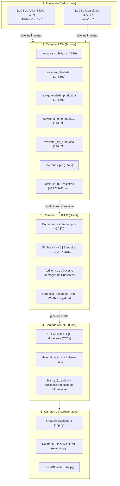
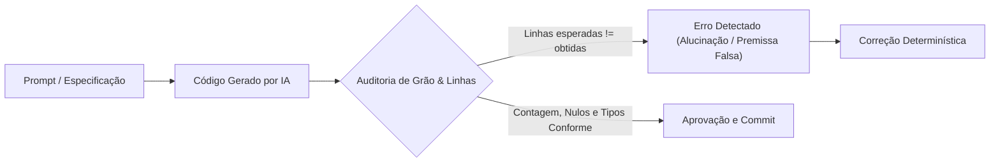

# 🌾 AgroData — Engenharia de Dados sobre a Produção Agrícola Municipal

[](https://www.python.org/)
[](https://duckdb.org/)
[](https://agrodata-projeto-enjenharia-de-dados--nivel-junior.streamlit.app/)
[](https://docs.pytest.org/)
[](https://docs.astral.sh/ruff/)
[-orange.svg)](#-arquitetura-medalhão)

Pipeline analítico de ponta a ponta projetado para processar, validar e explorar dados históricos da produção agrícola municipal brasileira. O projeto extrai dados públicos do **IBGE (Pesquisa Agrícola Municipal - PAM / SIDRA 5457)** e do **GOV.BR (Cadastro de Municípios)**, processa mais de **729 mil registros** em camadas medalhão com **DuckDB** e **Python**, materializa **15 marts analíticos em SQL puro** e disponibiliza os resultados em um **Dashboard Streamlit interativo** e em um **Relatório Executivo HTML independente**.

- 🌐 **Dashboard Interativo em Produção:** [agrodata.streamlit.app](https://agrodata-projeto-enjenharia-de-dados--nivel-junior.streamlit.app/)
- 📦 **Repositório do Projeto:** [github.com/elisiara/agrodata](https://github.com/elisiara/agrodata)
- 📑 **Relatório Executivo:** Gerado localmente em HTML estático reutilizável (`relatorio.html`).

---

## 📌 Sumário

1. [Visão Geral e Objetivos](#-visão-geral-e-objetivos)
2. [Tecnologias e Motivações Técnicas](#-tecnologias-e-motivações-técnicas)
3. [Estrutura do Repositório](#-estrutura-do-repositório)
4. [Fontes e Recorte Analítico](#-fontes-e-recorte-analítico)
5. [Modelagem de Dados e Semântica de Grão](#-modelagem-de-dados-e-semântica-de-grão)
6. [Arquitetura Medalhão](#-arquitetura-medalhão)
7. [Regras de Negócio e Engenharia de Qualidade](#-regras-de-negócio-e-engenharia-de-qualidade)
8. [Catálogo dos 15 Marts Analíticos](#-catálogo-dos-15-marts-analíticos)
9. [Aplicações de Consumo (Dashboard e Relatório)](#-aplicações-de-consumo)
10. [Guia de Execução Passo a Passo](#-guia-de-execução-passo-a-passo)
11. [Qualidade de Código e Testes Automatizados](#-qualidade-de-código-e-testes-automatizados)
12. [IA — Utilização de Inteligência Artificial e Governança](#-ia--utilização-de-inteligência-artificial-e-governança)

---

## 🎯 Visão Geral e Objetivos

O setor agrícola é um dos motores da economia brasileira, mas a análise de séries temporais municipais costuma enfrentar gargalos: extrações brutas volumosas com layouts não tabulares, cabeçalhos irregulares, convenções estatísticas próprias (hífens como zero, reticências como dado ausente) e risco de dupla contagem entre agregações municipais e nacionais.

O **AgroData** foi concebido com os seguintes objetivos de engenharia:
- **Reprodutibilidade Estrita (*Spec-Driven Development*):** Todo módulo e transformação segue especificações detalhadas, garantindo idempotência (`CREATE OR REPLACE`) e determinismo.
- **Eficiência e Baixo Custo Operacional:** Uso de um banco analítico colunar embedded (**DuckDB**), operando sobre disco local e memória, sem custos de cluster ou servidores dedicados.
- **Separação Rígida de Responsabilidades:** Camadas de UI e visualização nunca calculam regras de negócio (`groupby`, `sum`, `pivot`); todo indicador analítico é materializado e versionado em arquivos SQL modulares.
- **Governança e Auditoria:** Rastreabilidade centavo a centavo e hectare por hectare da camada bruta (`raw`) até as tabelas de consumo (`marts`).

---

## 🛠️ Tecnologias e Motivações Técnicas

| Tecnologia | Categoria | Por que foi escolhida? |
|---|---|---|
| **Python 3.12+** | Linguagem Core | Ecossistema maduro para engenharia de dados, tipagem estática e suporte aos pacotes analíticos modernos. |
| **DuckDB (>=2.0)** | Banco OLAP Embedded | Banco analítico colunar de altíssimo desempenho, ideal para processar centenas de milhares de linhas in-process sem servidor. |
| **SQL (DuckDB SQL)** | Transformação Analítica | Toda a camada de consumo é expressa em SQL modular (CTEs, Window Functions), desacoplando a lógica de negócio do código Python. |
| **uv** | Gerenciador de Pacotes e Ambientes | Alternativa ultrarrápida em Rust para gerenciar dependências de forma determinística via `pyproject.toml` e `uv.lock`. |
| **pandas** | Manipulação Tabular | Usado na interface e no orquestrador de ingestão para transição entre arquivos e frames relacionais. |
| **Streamlit** | Interface e Dashboard | Entrega ágil de aplicação web orientada a dados com layout responsivo e filtros interativos. |
| **Plotly** | Visualização de Dados | Gráficos vetoriais, mapas coropléticos e séries temporais com alta interatividade (tooltips, zoom). |
| **pytest & pytest-cov** | Testes e Qualidade | Testes unitários com dados sintéticos e bancos em memória temporários, garantindo cobertura superior a **93%**. |
| **Ruff** | Linter e Formatação | Linter e formatador estático em Rust, assegurando conformidade com PEP 8 e código limpo. |

---

## 📁 Estrutura do Repositório

```text
agrodata/
├── .agents/                 # Especificações formais das etapas (Spec-Driven Development)
├── data/                    # Malhas geográficas (GeoJSON de UFs brasileiras)
├── design/                  # Protótipos de interface e rascunhos visuais
├── pipeline/                # Scripts do pipeline ELT
│   ├── db.py                # Conexão centralizada com agrodata.duckdb e utilitários
│   ├── ingestao.py          # Leitura de CSVs e carga na camada raw
│   ├── transformacao.py     # Limpeza, tipagem e deduplicação na camada refined
│   └── marts.py             # Execução e materialização dos 15 SQLs em marts
├── raw/                     # Arquivos CSV originais imutáveis (IBGE PAM + GOV.BR)
├── sql/
│   └── marts/               # 15 consultas SQL analíticas independentes (NN_nome.sql)
├── test/                    # Suíte de testes unitários automatizados (48 testes)
├── app.py                   # Aplicação Streamlit (Dashboard com 4 abas e métricas)
├── painel.py                # Camada de apresentação pura (formatação e figuras Plotly)
├── relatorio.py             # Gerador do Relatório Executivo HTML independente
├── ui.py                    # Inicializador da extensão Web UI nativa do DuckDB
├── pyproject.toml           # Metadados do projeto e configurações de ferramentas
├── uv.lock                  # Lockfile com resolução exata de dependências
└── README.md                # Documentação completa do projeto
```

---

## 📊 Fontes e Recorte Analítico

### 1. Produção Agrícola Municipal — IBGE/PAM (Tabela SIDRA 5457)
- **Fonte Oficial:** [IBGE SIDRA — Tabela 5457](https://sidra.ibge.gov.br/tabela/5457)
- **Recorte Temporal:** **2000 a 2025** (26 anos contínuos).
- **Recorte Geográfico:** Nível Nacional (`BR`) e Municipal (`MU`).
- **Culturas Selecionadas (7 culturas estratégicas):**
  1. 🌾 Algodão herbáceo (em caroço)
  2. 🌾 Arroz (em casca)
  3. ☕ Café (em grão) Total
  4. 🫘 Feijão (em grão)
  5. 🌽 Milho (em grão)
  6. 🫛 Soja (em grão)
  7. 🌾 Trigo (em grão)

| Variável PAM | Unidade de Medida | Arquivo Fonte em `raw/` |
|---|---|---|
| **Área plantada ou destinada à colheita** | Hectares (ha) | `tabela5457_area_plantada_ou_destinada_a_colheita.csv` |
| **Área colhida** | Hectares (ha) | `tabela5457_area_colhida.csv` |
| **Quantidade produzida** | Toneladas (t) | `tabela5457_quantidade_produzida.csv` |
| **Rendimento médio da produção** | Quilogramas por hectare (kg/ha) | `tabela5457_rendimento_medio_da_producao.csv` |
| **Valor da produção** | Mil reais (mil R$) | `tabela5457_valor_da_producao.csv` |

> [!NOTE]
> O SIDRA possui séries iniciadas em 1988 (área) e 1994 (valor). O AgroData padronizou o intervalo de **2000 a 2025** para assegurar base comparativa idêntica entre todas as variáveis.

### 2. Cadastro de Municípios — GOV.BR / Receita Federal
- **Fonte:** [Dados Abertos da Receita Federal — Municípios](https://www.gov.br/receitafederal/dados/municipios.csv)
- **Arquivo em `raw/`:** `municipios_gov.csv` (codificação `Latin-1`).
- **Finalidade:** Normalização de códigos TOM, códigos IBGE de 7 dígitos, nomes oficiais e sigla da UF.

---

## 📐 Modelagem de Dados e Semântica de Grão

Compreender o grão de cada camada é o requisito fundamental para evitar armadilhas estatísticas e duplicações:

| Tabela / Camada | Grão da Tabela (O que representa uma linha?) | Volume de Linhas | Tipagem |
|---|---|:---:|---|
| **CSVs Brutos (PAM)** | Município/BR × Variável (com anos e culturas dispersos nas colunas) | 5.593 linhas/arquivo | Texto bruto com rodapés |
| **`raw.<tabela_pam>`** | Entidade territorial (`BR` ou `MU`) × Ano (com as 7 culturas em colunas) | **144.690** por tabela | `VARCHAR` (preservação estrita) |
| **`raw.municipio`** | Município brasileiro cadastrado no GOV.BR | **5.571** | `VARCHAR` |
| **Total Camada `raw`** | **Soma das 6 tabelas brutas no DuckDB** | **729.021** | Sem coerções numéricas |
| **`refined.<tabela_pam>`** | Entidade territorial (`BR` ou `MU`) × Ano (deduplicada e validada) | **144.690** por tabela | Numérico tipado (`BIGINT` / `DECIMAL`) |
| **`refined.municipio`** | Município único normalizado por código IBGE | **5.571** | `VARCHAR` |
| **Total Camada `refined`** | **Soma das 6 tabelas refinadas** | **729.021** | 0 duplicatas; integridade estrita |
| **`marts.<tabela>`** | Grão analítico específico de cada indicador (Brasil, UF, Cultura ou Município) | Variável (1 a 702 linhas) | Tipado e indexado para consumo |

> [!IMPORTANT]
> **Atenção ao Nível Geográfico (`nivel`):** Os dados do IBGE contêm registros municipais (`nivel = 'MU'`) e o registro agregado do Brasil (`nivel = 'BR'`). Somar linhas sem filtrar o nível provocaria **dupla contagem**. Consultas municipais operam exclusivamente com `nivel = 'MU'`, enquanto totalizadores nacionais rápidos utilizam `nivel = 'BR'`.

---

## 🏗️ Arquitetura Medalhão

O projeto adota o padrão de arquitetura Medalhão dentro de um único catálogo no arquivo local `agrodata.duckdb`:



### 🥉 Camada RAW (Bronze)
- **Execução:** `uv run python -m pipeline.ingestao`
- Preserva a verdade dos dados de entrada sem aplicar coerção de tipos ou descartar linhas com anomalias.
- Realiza o desdobramento do layout complexo do SIDRA (cabeçalhos de anos e produtos) em uma estrutura tabular de 26 anos por município.
- Todas as colunas são mantidas como `VARCHAR`.

### 🥈 Camada REFINED (Silver)
- **Execução:** `uv run python -m pipeline.transformacao`
- Aplica o vocabulário padronizado em `snake_case` e a tipagem explícita (`SMALLINT`, `BIGINT`, `DECIMAL(20,2)`).
- Verifica duplicatas de linha inteira e conflitos de chave primária.
- Garante idempotência: rodar uma ou dez vezes gera rigorosamente os mesmos **729.021 registros**.

### 🥇 Camada MARTS (Gold)
- **Execução:** `uv run python -m pipeline.marts`
- Lê exclusivamente de `refined` e materializa **15 tabelas** no schema `marts`.
- As regras analíticas residem 100% em arquivos `.sql` na pasta `sql/marts/`.
- Execução transacional atômica: se algum mart falhar ou produzir **0 linhas**, a execução sofre rollback completo para evitar estados inconsistentes no dashboard.

---

## 🔬 Regras de Negócio e Engenharia de Qualidade

### 1. Tratamento Semântico de Símbolos Estatísticos do IBGE
O IBGE adota convenções precisas que não podem ser simplificadas para nulos ou zeros indiscriminados:
- **`-` (Hífen):** Representa valor numérico igual a **zero** (fenômeno apurado onde a produção/área inexistiu).
- **`...` (Três pontos):** Dado ausente ou não informado.
- **`..` (Dois pontos):** Dado não disponível por ausência de informação na fonte primária.
- **`X` (Letra X):** Dado omitido para preservação do sigilo estatístico (segredo fiscal/industrial).
- **Campos Vazios / Espaços:** Tratados como `NULL`.

> [!CAUTION]
> O pipeline proíbe o uso de `TRY_CAST` ou `errors="coerce"`. Valores inválidos disparam interrupção imediata (`sys.exit(1)`). Um erro de conversão transformado silenciosamente em nulo seria indistinguível de uma ausência legítima de dado.

### 2. Rendimento Médio Agregado vs. Média Simples
Um erro comum em análises agronômicas é calcular a média dos rendimentos médios das culturas. O rendimento agregado do AgroData é rigorosamente formulado como:

$$\text{Rendimento Agregado (kg/ha)} = \frac{1000 \times \sum \text{Quantidade Produzida (t)}}{\sum \text{Área Colhida (ha)}}$$

### 3. Índice de Concentração Herfindahl-Hirschman (HHI)
Para aferir a diversificação da pauta agrícola dos estados (Mart 15), calcula-se o HHI sobre a participação percentual ($s_i$) das 7 culturas no valor da produção estadual:

$$HHI = \sum_{i=1}^{7} (s_i)^2 \quad \text{onde } s_i \in [0, 1]$$

- **Interpretação:** Quanto mais próximo de 1, mais monorregulada e dependente de uma única cultura é a economia agrícola da UF.
- **Número Efetivo de Culturas ($N_{eff}$):** Calculado como $N_{eff} = \frac{1}{HHI}$, indicando o número equivalente de culturas com pesos idênticos.

---

## 📋 Catálogo dos 15 Marts Analíticos

Cada mart é gerado a partir de um arquivo SQL dedicado em `sql/marts/`:

| Nº | Nome da Tabela em `marts` | Grão do Resultado | Indicador e Finalidade de Negócio |
|:---:|---|---|---|
| **01** | `ranking_valor_da_producao_muncipio_por_cultura` | 1 linha por cultura (7 linhas) | Identifica o município com maior valor acumulado de produção (2000–2025) por cultura. |
| **02** | `20_municipios_maiores_produtores_em_2025` | 1 linha por município (20 linhas) | Top 20 municípios em 2025 por valor total somado e volume colhido. |
| **03** | `municipios_maior_expansao_area_plantada` | 1 linha por município (10 linhas) | Top 10 municípios com maior incremento absoluto de área plantada (2000 a 2025). |
| **04** | `variacao_percentual_quantidade_produzida_por_cultura_2024_2025` | 1 linha por cultura (7 linhas) | Variação percentual e em volume físico produzido no Brasil de 2024 para 2025. |
| **05** | `percentual_area_plantada_colhida_em_2025` | 1 linha (Total Brasil) | Balanço nacional de perdas: área plantada vs. área colhida e taxa de colheita efetiva. |
| **06** | `diferenca_area_plantada_colhida_por_estado_2025` | 1 linha por UF (27 linhas) | Diferença em hectares entre área plantada e colhida agregada por estado em 2025. |
| **07** | `municipios_maior_aumento_quantidade_produzida_2000_2025` | 1 linha por município (10 linhas) | Top 10 municípios com maior aumento absoluto de produção em toneladas entre 2000 e 2025. |
| **08** | `evolucao_valor_producao_por_cultura_2000_2025` | 1 linha por ano/cultura (182 linhas) | Série histórica nacional anual (2000–2025) do valor da produção por cultura e variações anuais. |
| **09** | `expansao_area_sem_aumento_producao_2000_2025` | 1 linha por município | Lista municípios em que a área plantada cresceu mas o volume colhido caiu (anomalias/frustração de safra). |
| **10** | `distribuicao_geografica_producao_por_estado_2000_2025` | 1 linha por UF/ano (702 linhas) | Série temporal completa de participação percentual de cada UF na produção agrícola nacional. |
| **11** | `ranking_aumento_rendimento_medio_por_cultura_2000_2025` | 1 linha por cultura (7 linhas) | Ranking de ganhos de produtividade física (kg/ha) das culturas entre 2000 e 2025. |
| **12** | `resumo_totais_2025` | 1 linha (Resumo Brasil) | Quatro cartões executivos de 2025 com valores brutos e em escalas (bi R$, mi t, mi ha, t/ha). |
| **13** | `ranking_valor_bruto_por_hectare_cultura_2025` | 1 linha por município/cultura (70 linhas) | Top 10 municípios com maior valor monetário gerado por hectare colhido em cada cultura. |
| **14** | `ranking_municipios_evolucao_rendimento_agregado_2000_2025` | 1 linha por município (20 linhas) | Top 20 municípios com maior avanço percentual no rendimento ponderado global. |
| **15** | `concentracao_valor_producao_por_cultura_estado_2025` | 1 linha por UF/cultura (189 linhas) | Composição da receita por cultura em cada UF, ranking estadual e índices de concentração HHI. |

---

## 🖥️ Aplicações de Consumo

### 1. Dashboard Streamlit (`app.py` & `painel.py`)
O painel opera em layout panorâmico com atualização de cache sob demanda:
- **Cartões Nacionais Fixos (Topo):** Indicadores agregados de 2025 (R$ 553,24 bi em valor, 313,26 mi t produzidas, 79,27 mi ha colhidos e rendimento médio de 3,95 t/ha).
- **Aba 1 — Panorama:** Gráfico de rosca de perdas de safra, evolução histórica das 7 culturas com seleção de período e líderes municipais.
- **Aba 2 — Distribuição por Estado:** Mapa coroplético e gráficos de participação por UF sincronizados por seletor de ano, além do índice de concentração HHI.
- **Aba 3 — Expansão e Rankings:** Balanço 2024–2025, rankings municipais de expansão e lista investigativa de municípios com expansão sem ganho de produção.
- **Aba 4 — Produtividade e Valor/ha:** Comparação física de rendimento e ranking de eficiência de receita bruta por hectare colhido.

### 2. Relatório Executivo HTML (`relatorio.py`)
Gera um documento autônomo (`relatorio.html`) estilizado com paleta agrícola profissional, renderizando tabelas consolidadas e gráficos Plotly estáticos reutilizados de `painel.py`. Ideal para apresentações executivas offline sem necessidade de servidor ativo.

### 3. DuckDB Web UI (`ui.py`)
Permite ao engenheiro de dados ou analista explorar interativamente as tabelas dos schemas `raw`, `refined` e `marts` via navegador, executando consultas ad-hoc no endereço `http://localhost:4213`.

---

## 🚀 Guia de Execução Passo a Passo

### Pré-requisitos
- **Git**
- **Python 3.12+**
- **uv** ([Instruções de instalação do uv](https://docs.astral.sh/uv/))

### 1. Clonar o Repositório e Instalar Dependências

```bash
git clone https://github.com/elisiara/agrodata.git
cd agrodata
uv sync --all-groups
```

### 2. Executar o Pipeline de Engenharia de Dados

Execute sequencialmente para construir as camadas Medalhão em `agrodata.duckdb`:

```bash
# Etapa 1: Ingestão dos CSVs para a camada raw (729.021 linhas)
uv run python -m pipeline.ingestao

# Etapa 2: Limpeza, tipagem e deduplicação para refined (729.021 linhas)
uv run python -m pipeline.transformacao

# Etapa 3: Materialização das 15 consultas analíticas em marts
uv run python -m pipeline.marts
```

### 3. Abrir o Dashboard Interativo

```bash
uv run streamlit run app.py
```
Acesse o link local exibido no terminal (por padrão: `http://localhost:8501`).

### 4. Gerar o Relatório Executivo HTML (Opcional)

```bash
uv run python -m relatorio
```
O arquivo `relatorio.html` será gerado na raiz do repositório.

### 5. Explorar o Banco no DuckDB Web UI (Opcional)

```bash
uv run python ui.py
```
Acesse `http://localhost:4213` no navegador. Pressione `Ctrl + C` para encerrar e liberar a conexão.

---

## 🧪 Qualidade de Código e Testes Automatizados

O projeto adota testes unitários isolados baseados em **dados sintéticos** e instâncias temporárias do DuckDB gerenciadas por fixtures (`tmp_path`). Nenhum teste consulta o banco de produção `agrodata.duckdb` ou depende da existência prévia dos CSVs.

### Executar Testes com Cobertura de Código

```bash
uv run pytest --cov
```

- **Meta Mínima Exigida:** 60%
- **Resultado Atual:** **48 testes aprovados**, com cobertura total de **93,45%**.
- **Módulos Auditados:** `pipeline/db.py`, `pipeline/ingestao.py`, `pipeline/transformacao.py`, `pipeline/marts.py`, `painel.py` e `relatorio.py`.

### Executar Linter e Verificação de Formatação

```bash
# Análise estática de código
uv run ruff check .

# Verificação de conformidade de formatação
uv run ruff format --check .
```

---

## 🤖 IA — Utilização de Inteligência Artificial e Governança

A inteligência artificial foi empregada como **copiloto de desenvolvimento** em todo o ciclo de vida do AgroData: aceleração na estruturação de especificações técnicas (*Spec-Driven Development*), geração preliminar de scripts Python, rascunho de consultas SQL analíticas, componentes visuais do dashboard e criação de cenários de teste unitário.

Entretanto, a premissa fundamental do projeto foi a de que **código gerado por IA é apenas uma hipótese técnica que deve ser provada contra a integridade dos dados**. A IA não substitui a governança, o desenho de arquitetura nem o entendimento aprofundado do negócio.

### Em que etapas a IA errou ou assumiu premissas não solicitadas, e como foi identificada?

A principal ferramenta de controle utilizada para auditar e desmascarar alucinações ou atalhos da IA foi a **conferência sistemática de contagem de linhas e grãos (linhas antes vs. linhas depois)**:



| Etapa do Pipeline | O que a IA errou ou assumiu sem ser solicitado? | Impacto no Dado se não fosse auditado | Como foi descoberto e corrigido? |
|---|---|---|---|
| **Marts Analíticos (SQL)**<br/>*Mart 10 — Distribuição Geográfica* | Ao codificar a distribuição temporal de 2000 a 2025, a IA utilizou `WHERE ano IN (2000, 2025)`, considerando apenas os dois anos das pontas em vez do intervalo completo. | Perda de 24 anos da série temporal; o gráfico de evolução histórica por estado ficaria quebrado no dashboard. | **Contando linhas do mart:** A execução gerou apenas **54 linhas** (27 UFs × 2 anos), quando o grão exigia exatamente **702 linhas** (27 UFs × 26 anos). Corrigido para `WHERE ano BETWEEN 2000 AND 2025`. |
| **Marts Analíticos (SQL)**<br/>*Mart 15 — Concentração por Estado* | A IA aplicou um filtro `WHERE ranking = 1`, restringindo o resultado final apenas à cultura líder de cada estado. | Impossibilitava calcular a composição percentual das 7 culturas e desvirtuava o cálculo do HHI no dashboard. | **Contando linhas do mart:** A tabela retornou apenas **27 linhas** (1 por UF). O grão correto de composição exigia **189 linhas** (27 UFs × 7 culturas). O filtro indevido foi removido. |
| **Ingestão de Dados (Raw)**<br/>*Formatação dos CSVs* | A IA assumiu premissas uniformes: que todos os arquivos eram delimitados por `;` e codificados em `UTF-8`. | O arquivo de área plantada falhava por usar delimitador vírgula (`,`) e o de municípios gerava caracteres corrompidos por estar em `Latin-1`. | **Pela meta matemática de contagem de linhas:** O contrato exigia estritamente **144.690 linhas** por tabela PAM e **5.571 municípios** (total de **729.021 registros**). Falhas de delimitador quebravam a contagem. |
| **Ingestão de Dados (Raw)**<br/>*Cabeçalhos Irregulares do SIDRA* | A IA sugeriu usar `pandas.read_csv` genérico descartando linhas irregulares. A linha 4 do SIDRA omitia 6 células em branco no final (179 campos vs 185 das linhas de dados). | Truncamento silencioso de colunas do ano de 2025 ou falha fatal na carga. | **Validação explícita de largura de campos:** Construiu-se um algoritmo dedicado com `csv.reader` que preenche os campos vazios até 185 e propaga os anos corretamente. |
| **Transformação (Refined)**<br/>*Conversão Numérica e Nulos* | A IA tentou usar abordagens permissivas (`TRY_CAST` ou `errors="coerce"`), além de tentar converter o hífen `-` (zero) em `NULL`. | Nulos legítimos seriam indistinguíveis de falhas de conversão, e áreas onde nada foi produzido seriam desconsideradas em vez de somadas como zero. | **Spec de conferência com auditoria antes/depois:** Foi exigida uma tabela prévia comparando linhas de entrada, saída, nulos por coluna e falhas de conversão, forçando `CAST` estrito que interrompe o pipeline em caso de anomalia. |
| **Testes Unitários**<br/>*Isolamento de Testes* | A IA tentou conectar os testes ao banco real `agrodata.duckdb` e fixar nos testes as contagens exatas do IBGE (`729.021`, `144.690`). | Os testes dependeriam do pipeline ter rodado previamente, testando a fotografia dos dados em vez da lógica das funções. | **Critério de aceite na spec de testes:** Proibiu-se explicitamente o uso dessas constantes em `test/`. Forçou-se o uso de `tmp_path`, bancos voláteis e dados sintéticos mínimos. |

### Conclusão sobre o Uso de IA em Engenharia de Dados
O caso do AgroData evidencia que LLMs são multiplicadores de produtividade excepcionais para tarefas repetitivas e geração de estruturas de código, mas **completamente vulneráveis a premissas sutis de negócio e semântica de agregação**. A única salvaguarda para manter a fidelidade e a qualidade do dado em pipelines modernos é a aplicação rigorosa de testes, especificações contratuais e **auditoria contínua de grãos e contagens de linhas**.

---

## 👩‍💻 Autoria e Licença

Desenvolvido por **Elisiara** como projeto prático integrador da **Pós-Graduação em Engenharia de Dados e Inteligência Artificial**.

- **GitHub:** [@elisiara](https://github.com/elisiara)
- **Licença:** Distribuído sob a licença MIT. Consulte `LICENSE` para mais informações.
